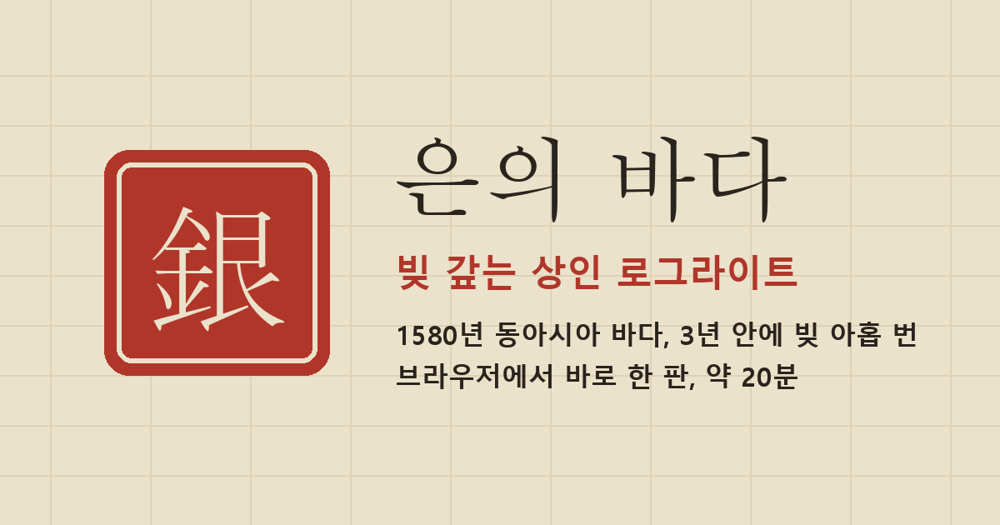

# 은의 바다

**빚 갚는 상인 로그라이트.** 1580년 류큐 나하, 큰 빚을 진 상인이 되어 3년 동안 아홉 번에 걸쳐 빚을 갚아야 합니다.

▶ **바로 플레이: https://leexnghs-commits.github.io/eunui-bada/**

설치 없이 브라우저에서 돌아갑니다. PC와 휴대폰 모두 됩니다. 한 판은 20분 안팎입니다.

## 어떤 게임인가

- 부산포, 나가사키, 나하, 영파, 마카오, 마닐라 여섯 항구를 오가며 비단, 은, 도자기, 후추, 유황을 사고팝니다.
- 상점에서 **직원**을 고용합니다. 물건을 팔 때마다 직원들이 1번 자리부터 차례로 이익을 불립니다. 어떤 직원을 어떤 순서로 앉히느냐가 승패를 가릅니다.
- 상환일이 지나가면 현금과 예금에서 빚을 걷어 갑니다. 모자라면 연체, 그다음은 급매, 그래도 모자라면 파산입니다.
- 해마다 연말에는 결산 보스가 규칙을 비틉니다. 해적, 폭풍, 역병도 기다립니다.
- 난이도는 견습, 상인, 거상 세 단계입니다. 처음이면 견습을 권합니다.

## 개발 중인 시험판입니다

밸런스와 규칙이 자주 바뀝니다. 진행 상황은 브라우저에 저장되므로 창을 닫았다 열어도 이어서 할 수 있습니다.

**플레이 기록:** 처음 시작할 때 동의를 고르면 게임 진행 기록(별명, 매매와 항해 같은 진행, 판이 끝난 뒤 설문)을 개발자에게 보냅니다. 이름, 연락처 같은 개인정보는 모으지 않습니다. **기록 없이 하기**를 고르면 아무것도 보내지 않고 똑같이 플레이할 수 있습니다.

## 저작권

© 2026 leexnghs-commits. 모든 권리 보유. 플레이는 자유롭게 하셔도 되지만, 코드와 그림을 다른 곳에 다시 배포하거나 고쳐서 내놓는 것은 허락하지 않습니다.
